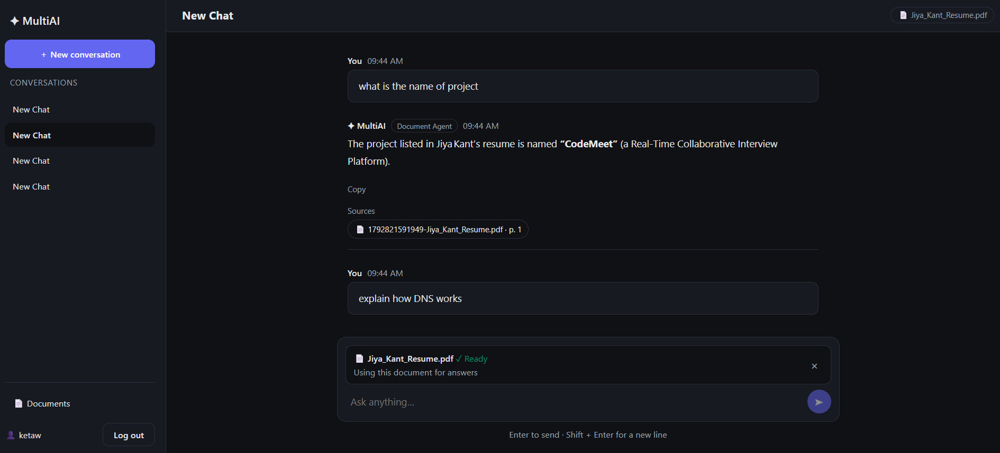
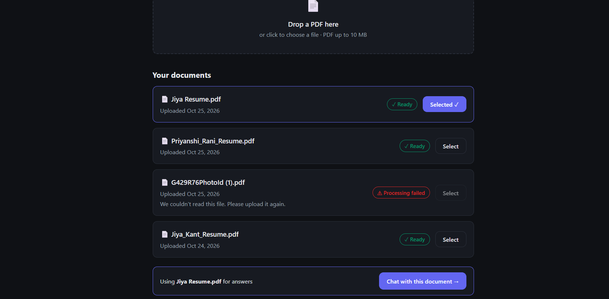
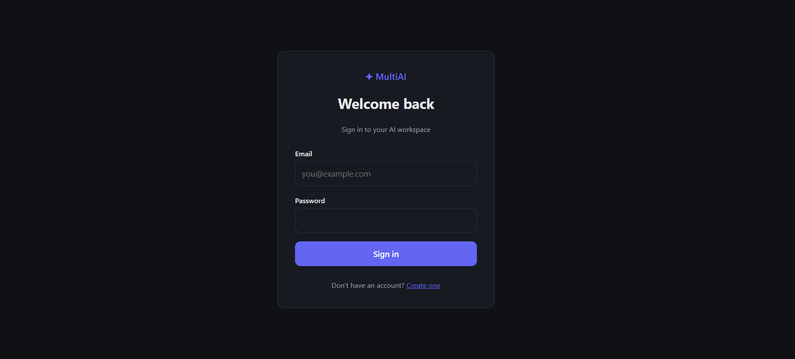
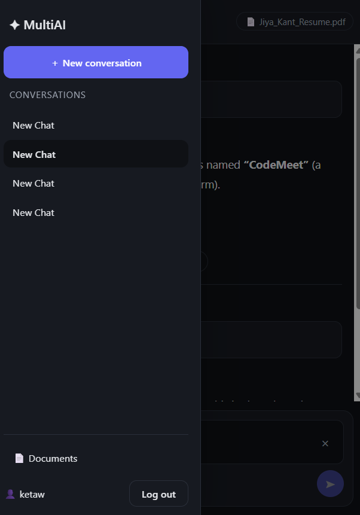

# ✦ MultiAI Workspace

A multi-agent AI workspace that combines specialized AI agents, document-aware
RAG, conversation memory and real-time document processing.



## Features

- **Supervisor-based routing (LangGraph):** a supervisor reads each request and sends it to a Coding, Research or Document agent
- **Document RAG:** upload a PDF, ask questions about it, and get answers with source file names and page numbers
- **Local embeddings:** `all-MiniLM-L6-v2` (384 dimensions) runs inside the backend, with vectors stored in **Qdrant** and filtered per document
- **Redis:** caches retrieval results (5 minutes), rate-limits chat requests (20 per minute per user), and powers the job queue and pub/sub
- **Background processing:** BullMQ worker ingests PDFs with 3 retry attempts
- **Real-time status:** Socket.IO updates a document from *Processing* to *Ready* without a refresh
- **Conversation memory:** the last 10 messages of a chat are sent to the model
- **Security:** JWT (7-day tokens), bcrypt password hashing, Zod request validation, per-user data isolation
- **Responsive UI** with automatic dark mode
- **Docker Compose:** the whole stack starts with one command

## Screenshots

| Chat with sources | Documents |
|---|---|
|  |  |

| Login | Mobile |
|---|---|
|  |  |

## Tech stack

| Layer | Technology |
|---|---|
| Frontend | React, Redux Toolkit, Vite, Socket.IO client |
| Backend | Node.js, Express, MongoDB (Atlas), Mongoose, Zod |
| AI | LangChain, LangGraph, Groq (`openai/gpt-oss-120b`), Hugging Face Transformers (local embeddings) |
| Infrastructure | Qdrant, Redis, BullMQ, Socket.IO, Docker Compose |

## Architecture

```
                    React + Redux (Vite)
                           │  REST + Socket.IO
                           ▼
                     Express API
          (JWT auth · Zod validation · rate limit)
        ┌──────────────────┼──────────────────┐
        ▼                  ▼                  ▼
    MongoDB              Redis            LangGraph
 users, chats,     cache · rate limit        │
 messages, docs    BullMQ · pub/sub     Supervisor
                                             │
                          ┌──────────────────┼──────────────────┐
                          ▼                  ▼                  ▼
                       Coding            Research           Document
                       Agent              Agent              Agent
                                                               │
                                                  embeddings → Qdrant
```

**Chat flow:** message → rate limit → saved in MongoDB → supervisor → agent → answer (and sources) saved and returned.

**Document flow:**
```
Upload PDF → API saves the file and a Document ("processing")
          → BullMQ queue (Redis)
          → Worker: read PDF → split into chunks → embed → store in Qdrant
          → Redis pub/sub → API → Socket.IO → the card shows "Ready"
```
When a document is selected in the UI, the supervisor routes straight to the Document Agent, which searches only that document.

## Getting started

### With Docker (recommended)

```bash
git clone https://github.com/jiya656/multi-agent-AI.git
cd multi-agent-AI
```
1. Create `backend/.env.docker` from `backend/.env.example` and fill in your MongoDB URI, JWT secret and Groq API key. Use the Docker service names:
   ```
   REDIS_URL=redis://redis:6379
   QDRANT_URL=http://qdrant:6333
   ```
2. Start everything:
   ```bash
   docker compose up -d --build
   ```
3. Create the vector collection (first run only):
   ```bash
   docker compose exec backend node src/ai/vector/createDocumentCollection.js
   ```
4. Open http://localhost:5173 and register an account.

The first document question downloads the embedding model (about 90 MB). It is stored in the `hf_cache` volume, so it downloads only once.

### Local development (without Docker for the app)

```bash
docker compose up -d redis qdrant          # infrastructure only

cd backend
npm install --legacy-peer-deps
cp .env.example .env                       # fill in the values
node src/ai/vector/createDocumentCollection.js
npm run dev                                # API on :5000
npm run worker                             # in a second terminal

cd ../frontend
npm install
npm run dev                                # UI on :5173
```

## Environment variables

| Variable | Description |
|---|---|
| `PORT` | API port (default `5000`) |
| `MONGODB_URI` | MongoDB connection string |
| `JWT_SECRET` | Secret used to sign tokens |
| `LLM_API_KEY` | Groq API key |
| `LLM_MODEL` | Model name (default `openai/gpt-oss-120b`) |
| `REDIS_URL` | Redis connection URL |
| `QDRANT_URL` | Qdrant URL |
| `DEBUG_LOGS` | `true` prints agent pipeline logs (they include user questions); keep `false` in production |

Real `.env` files are never committed.

## API overview

| Method | Path | Description |
|---|---|---|
| POST | `/api/auth/register`, `/api/auth/login` | Create an account / get a token |
| GET | `/api/auth/profile` | Current user |
| POST, GET | `/api/chats` | Create / list conversations |
| GET, DELETE | `/api/chats/:id` | Read (with messages) / delete a conversation |
| POST | `/api/chats/:id/messages` | Send a message (rate limited; optional `documentId`) |
| POST | `/api/documents/upload` | Upload a PDF (max 10 MB) |
| GET | `/api/documents` | List your documents and their status |

## Project structure

```
backend/
  src/
    ai/          agents, graph (supervisor + nodes), prompts, rag, vector, models
    controllers/ routes/ middleware/ models/ services/ validators/
    jobs/        BullMQ queue and worker
  worker.js      worker entry point
frontend/
  src/
    components/  chat, sidebar, agents, documents
    pages/       Login, Register, Dashboard, Chat, Documents
    redux/       auth, chat and document slices
docs/            development log, testing checklist, screenshots
```

Developer scripts (run with `node`): `src/ai/rag/testRag.js`, `testRagQuality.js`,
`testDocumentFiltering.js`, `testDocumentAgent.js`, `testRetrieval.js`, and
`src/ai/vector/createCollection.js`.

## Testing

The manual testing checklist is in [`docs/testing-checklist.md`](docs/testing-checklist.md).
The day-by-day build history is in [`docs/development-log.md`](docs/development-log.md).

## Known limitations

- The free Groq tier limits tokens per minute, so heavy use returns a 429 error. Output length is capped and only the last 10 messages are sent to reduce this.
- Socket.IO status events are broadcast to every connected client (they contain only a document id and status). Per-user rooms with authenticated sockets are planned.
- The "Analyzing / Searching / Preparing" steps in the chat are estimated phases, because the API returns one response per message.
- Documents cannot be deleted or retried from the UI, and a failed upload stays in the list.
- If Redis is unreachable at upload time, a document can stay on *Processing*.
- If your computer sleeps, the worker's Redis connection can go stale; `docker compose restart worker` fixes it.
- The Docker images contain a copy of the code, so code changes need `docker compose up -d --build`.
- The rate limiter's error body uses `message` instead of the `error` key used elsewhere.

## Future improvements

- Authenticated Socket.IO rooms and real agent progress events
- Delete and retry for documents; mark stale *Processing* documents as failed
- Streaming responses
- Return-to-supervisor loop for multi-step requests (for example, "read my PDF, then research X")
- Automated tests and CI
- Deployment (cloud hosting for the API, worker and vector database)